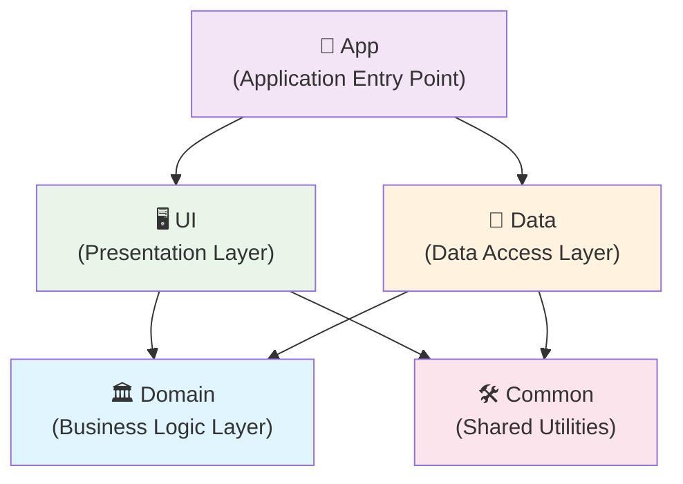

# ☕돌구타이머(DGTimer)
### 수동으로 커피를 추출하는 돌체 구스토 머신을 사용하는 사람들을 위한 캡슐 추출 타이머

- 다양한 종류의 캡슐을 알맞은 양으로 추출할 수 있도록 각각의 시간과 타이머를 제시합니다.
- 상단의 검색 기능으로 사용자가 찾는 캡슐을 선택할 수 있고, 자주 사용하는 캡슐을 즐겨찾는 목록에 등록하여 찾아보기 쉽게 할 수 있습니다.
- 타이머는 자유롭게 재생, 일시정지, 리셋이 가능하며 시간이 끝날 때 울리는 알람의 종류(소리 or 진동)을 설정할 수 있습니다.


## ⛓ 링크
[! NOTE] 현재 앱은 배포가 중지된 상태입니다.
[구글플레이](https://play.google.com/store/apps/details?id=com.tyehooney.dgtimer)
<br>
 
## 🏗️ 아키텍처

### 모듈 구조
이 프로젝트는 **Clean Architecture** 원칙을 따르는 멀티 모듈 구조로 설계되었습니다:



### 모듈별 역할
- **🏁 App**: 애플리케이션 진입점, 의존성 주입 설정, Firebase 초기화
- **🖥️ UI**: Activities, ViewModels, Adapters, 위젯 등 프레젠테이션 레이어
- **🏛️ Domain**: Use Cases, Repository 인터페이스, 도메인 모델 (순수 Kotlin)
- **💾 Data**: Repository 구현체, Room 데이터베이스, Firebase 연동
- **🛠️ Common**: SharedPreferences, 유틸리티 클래스 등 공통 모듈

### 의존성 방향
```
UI → Domain ← Data
↓         ↗
Common ←──┘
```
- **의존성 역전 원칙**: UI와 Data 모듈은 Domain의 인터페이스에만 의존
- **단방향 의존성**: 내부 계층(Domain)은 외부 계층에 의존하지 않음
- **공통 모듈**: 여러 모듈에서 사용하는 코드를 Common 모듈로 분리

## 🛠 기술 스택
### 아키텍처 & 디자인 패턴
- [**Clean Architecture**](https://blog.cleancoder.com/uncle-bob/2012/08/13/the-clean-architecture.html) - 계층별 관심사 분리
- [**MVVM Pattern**](https://developer.android.com/jetpack/guide) - UI와 비즈니스 로직 분리
- [**Repository Pattern**](https://developer.android.com/jetpack/guide#fetch-data) - 데이터 소스 추상화
- [**Use Case Pattern**](https://developer.android.com/jetpack/guide#domain-layer) - 비즈니스 로직 캡슐화

### Android Architecture Components
[AAC ViewModel](https://developer.android.com/topic/libraries/architecture/viewmodel)  
[Flow](https://kotlinlang.org/docs/flow.html) & [StateFlow](https://developer.android.com/kotlin/flow/stateflow-and-sharedflow)  
[DataBinding](https://developer.android.com/topic/libraries/data-binding)  
[DiffUtil](https://developer.android.com/reference/androidx/recyclerview/widget/DiffUtil)  

### 라이브러리
[Glide](https://github.com/bumptech/glide) - 이미지 로딩  
[Room](https://developer.android.com/training/data-storage/room?hl=ko) - 로컬 데이터베이스  
[Hilt](https://developer.android.com/training/dependency-injection/hilt-android) - 의존성 주입  
[Firebase](https://firebase.google.com/) - 원격 데이터베이스 & 크래시 분석

## 💻개발자
[박태훈](https://github.com/tyehooney)
